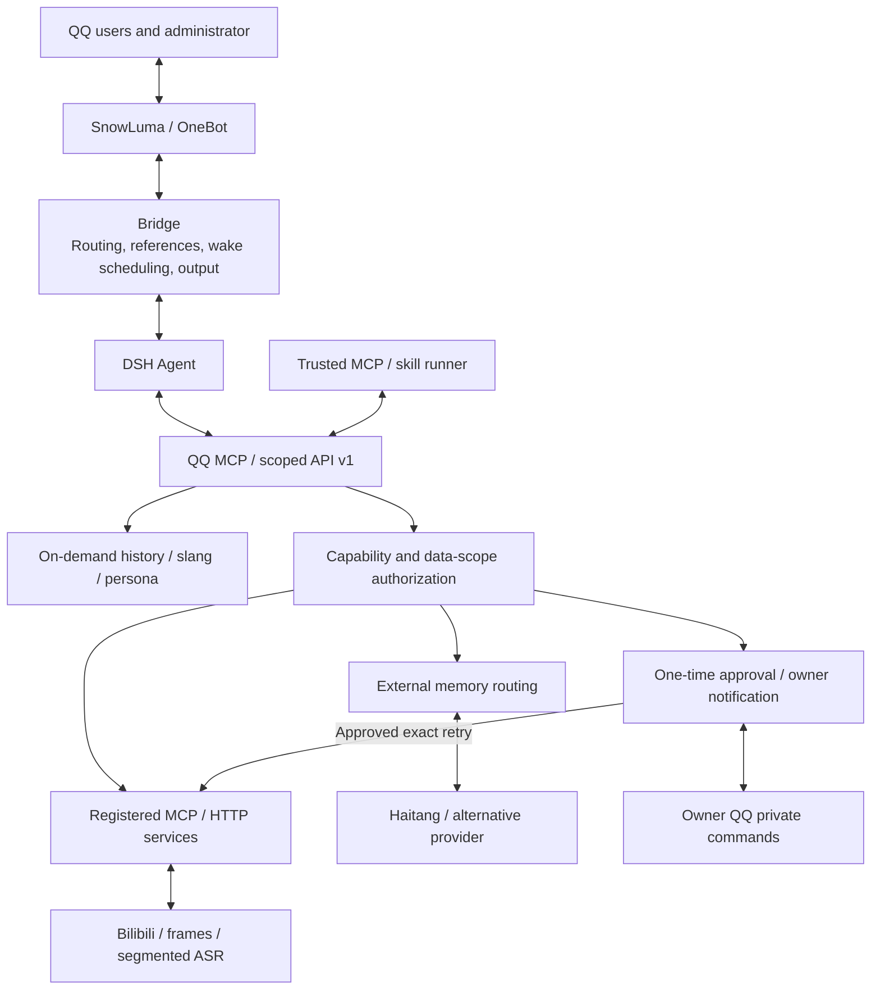

# QQ-bridge-pro: an extensible framework for QQ agents

[中文](README.md) · [Architecture diagrams](docs/guides/FRAMEWORK_ARCHITECTURE.md) · [Documentation](docs/README.md) · [Permission rules](RULES.md)

Connect QQ groups and private conversations to DeepSeek Harness (DSH). Agents retrieve relevant context, select content and memory services when needed, and reply through QQ.

**This repository extends [Derpyu520/qq-bridge](https://github.com/Derpyu520/qq-bridge) and combines work from DSH, SnowLuma, dsh-bilibili, Haitang and their communities.** The upstream bridge supplies the messaging connection, modes, tool restrictions and console. This fork adds scoped APIs, content-service integration, external memory routing, extension approvals and timeline-based evidence. Underlying modules and models remain the work of their respective projects; see the acknowledgements below.

## Implemented capabilities

| Area | Available functionality |
| --- | --- |
| QQ messaging | Group/private routing, unread reads, quoted replies, waits, read watermarks, allowlists and pause controls |
| On-demand context | Social v2 requests relevant history, slang, persona and memory instead of attaching them to every wake |
| Extension interfaces | Conversation-scoped API v1, dependency-free `QQBridgeClient`, external MCP/skill-runner examples |
| Content services | Typed content with `sourceId`; agent-selected calls to fixed registered MCP/HTTP providers |
| Video and animation | Bilibili subtitles, segmented ASR, uniform/scene frames, absolute timestamps and continuation inputs; received video and GIF/WebP |
| Speech recognition | Gateway WAV conversion and local SenseVoice recognition, without a new cloud ASR account |
| Output | Text, links, images, stickers and voice handles; **no speech-generation/TTS provider is integrated** |
| External memory | Replaceable HTTP/MCP providers, Haitang adapter and conversation namespaces; no old built-in fallback |
| Authorization | Conversation/capability/data-scope grants, single-use approvals, owner QQ notifications, private commands and audit |
| Business extensions | Explicitly authorized, time-limited debate tasks with a separate analysis worker |

Providers must be prepared and configured separately. An available interface does not mean every provider is installed or every incoming message is automatically recognized.

## Architecture



The [detailed architecture document](docs/guides/FRAMEWORK_ARCHITECTURE.md) contains six diagrams for the main flow, context, approvals, media evidence, memory/business extensions and Linux deployment, plus implementation entry points and limitations.

## Extension entry points

- [API v1 and client](docs/guides/EXTENSION_API.md): scoped credentials and external runners.
- [Content framework](docs/guides/CONTENT_FRAMEWORK.md): source references, schemas, fixed transports and output handles.
- [Approvals](docs/guides/EXTENSION_PERMISSIONS.md): exact grants and single-use permits.
- [Media services](docs/guides/VIDEO_SERVICES.md): Bilibili/video/GIF/speech setup and limits.
- [Memory providers](docs/guides/MEMORY_PROVIDERS.md) and [Haitang](docs/guides/HAITANG_MEMORY.md): replaceable storage and retrieval.
- [Dual-mode routing](docs/DUAL_MODE.md) and [debate tasks](docs/guides/DEBATE_PLUGIN.md): separate administrator/business boundaries.

For ask requests, the bridge privately notifies `ownerQQ` with the conversation, capability, redacted input summary and request ID. The owner can privately send `/approve requestId` or `/deny requestId`, or use the console. Group/non-owner messages cannot approve. Duplicate pending requests do not generate repeated notifications.

**Approval itself does not execute or resume the agent.** Ask the original conversation to retry the same source and parameters with the approval ID. Permits expire five minutes after creation, cannot be replayed, and are not restored after restart. Notification failures never grant access. Ordinary write/execute effects still need approval even with allow rules; explicitly registered automatic-memory providers follow their separate policy. DSH-native approvals use a separate mechanism.

Before `npm run setup:media` or `npm run setup:memory:haitang`, prepare the documented upstream source, runtime/model assets and independent data directory. Linux needs appropriate paths. Setup does not download all dependencies. Haitang's local store/retrieval is reused without its host auto-injection hooks; automatic authorization does not imply automatic full-chat ingestion.

External runners receive scoped conversation credentials from a trusted host, not by reading console secrets. The framework does not install MCP servers, scan skills or offer generic hot-loading plugins.


### External client example

```js
import { QQBridgeClient } from 'qq-bridge/client';

const client = new QQBridgeClient({
  baseUrl: 'http://127.0.0.1:3100',
  key: currentConversation.key,
  token: currentConversation.token,
  timeoutMs: 190000,
});
await client.contentServices(sourceId);
await client.processContent('bilibili.frames', {
  sourceId,
  input: { sampling: 'scene', startSeconds: 120, durationSeconds: 30, maxFrames: 4 },
});
```

`currentConversation` comes from a trusted host and `sourceId` from received content. This is an integration fragment, not a credential bootstrap. The package import assumes this repository is installed/linked as a dependency; repository scripts may import `./src/bridge-client.mjs`.

## Version and provenance

The package retains upstream base version **`0.2.0-r4`**. Compatibility has been checked against **DSH 0.2.0-rc.2**. This fork's framework work lives on **`feature/per-conversation-dual-mode`**; do not assume the default branch includes it. This is not a new upstream release announcement.

DSH integration uses persistent local signing material for Cookie authentication, slash RPC and event streams. Normally leave `dsh.authToken` empty. Presets use bundle patches, not the obsolete `~/.dsh/.agent-presets/` directory mechanism. See [adaptation notes](docs/guides/DSH_020_ADAPTATION.md).


## Requirements

- Node.js >= 22.13
- Running DeepSeek Harness Web (default `http://127.0.0.1:3080`)
- Running SnowLuma with OneBot v11 WebSocket and HTTP API enabled

## Quick Start

```bash
git clone --branch feature/per-conversation-dual-mode https://github.com/Cross090525/QQ-bridge-pro.git
cd QQ-bridge-pro
npm install        # postinstall automatically patches the @snowluma/sdk ESM packaging bug
```

Copy `config.example.json` to `config.json`, then edit:

```bash
cp config.example.json config.json
```

Key settings:

| Field | Description |
| --- | --- |
| `dsh.baseUrl` | DSH Web API URL, default `http://127.0.0.1:3080` |
| `dsh.authToken` | DSH launch token (a process-launch credential). **Normally leave this empty**: with no token the bridge mints the session cookie offline from the persistent signing key in `~/.dsh/.credentials.yaml`, which depends on no per-process state (since DSH 0.1.7 the launch token lives only in memory — the one in the old logs belongs to a previous process and only yields a 401). A value here is honoured first if you set one |
| `dsh.authHeader` / `dsh.authPrefix` | Legacy fields kept for compatibility; the current path uses Cookie auth and does not send this header |
| `snowluma.wsUrl` | SnowLuma OneBot **WebSocket** URL (e.g. `ws://127.0.0.1:3001`) |
| `snowluma.accessToken` | OneBot access token, leave empty if not configured |
| `snowluma.httpUrl` | OneBot **HTTP API** URL (e.g. `http://127.0.0.1:3000`); do not point this at the WebSocket port or you will get HTTP 426 |
| `ownerQQ` | Administrator QQ (highest privilege) |
| `allow.private` / `allow.groups` | Whitelist of QQ/group IDs |
| `consolePort` | Local console port, default `3100` |

Start:

```bash
npm start
```

Or double-click `start.bat` on Windows (guard mode with auto-restart).

## DSH Setup on Every New Installation

Install the chat presets (`qq-chat` and `qq-chat-v2`) and MCP configuration on every new installation, including a single-machine setup. Set `DSH_HOME` first when using a custom directory:

```bash
node scripts/setup-dsh.mjs
```

This installs:

- the `qq-agent-presets` bundle, which generates the two `@deepseek-ai/dsh-agent-preset` rows (`qq-chat`, `qq-chat-v2`) plus the shared `qq-tool-restrict` safety guard
- MCP entries in `~/.dsh/profiles/web/cordis.patch.yml`
- `qq-mode-console` and `qq-agent-presets` in the profile `package.json` (`bundles` + `link:` dependencies)
- Default DSH mode set to `reserved2` (second-generation simulation), with a local `state/mode.json` fallback

Then restart DSH. See [docs/guides/DSH_SETUP.md](docs/guides/DSH_SETUP.md) for details.

## Security Notes

- `config.json` and `state/` are **never committed**; the repository only ships `config.example.json`. Both are ACL-hardened to the owner / SYSTEM / Administrators (`npm run harden-acl`).
- MCP send tools enforce whitelist checks and reject CQ-code injection.
- Local paths, credentials, tokens and other sensitive patterns are filtered by the audit layer.
- Simulation sessions get **no local execution tools at all**: the preset's `qq-tool-restrict` row hides them from the tool schema at registration time and a runtime allowlist rejects anything outside the QQ MCP namespaces (`npm run scan:tool-names` re-checks that list against the installed DSH).
- The console uses a generated token when none is configured.

## Repository Layout

```
qq-bridge/
  config.example.json   # sanitized config template (real config.json is not in repo)
  docs/
    README.md           # documentation index (one line per doc + "still current?" notes)
    FOLDER_MAP.md       # folder layout and scripts/ naming conventions
    guides/             # architecture, setup, media, memory, permissions and operations
    DUAL_MODE.md        # separate group simulation and administrator routing
  dsh/agent-presets/    # qq-chat / qq-chat-v2 DSH agent preset templates
  plugins/qq-agent-presets  # DSH bundle: generates the qq-chat / qq-chat-v2 preset patch rows + the shared tool guard
  plugins/qq-mode-console  # DSH plugin: exposes the qq-mode settings namespace (host half only; no UI card yet)
  integrations/         # media and Haitang provider adapters
  examples/             # external clients/providers and business workers
  src/                  # bridge core, scoped client, framework and MCP servers
  public/
    console.html        # local web console
  roles/                # persona cards
  assets/               # images (the intro video ships as a release asset, not in the repo)
  scripts/              # tests and helper scripts
  state/                # runtime data (not in repo)
```

The optional standalone **voice sender tool** (not included by cloning this repository and not a bridge prerequisite) (`voice-cli.mjs`, `voice-gui.mjs`, `public/voice.html`, `发语音.cmd`)
lives in the sibling folder **`../voice-tool/`** — it only needs SnowLuma, and reuses this repo's
`src/voice-core.js` / `src/snowluma-conn.js` as the single shared implementation.

## Testing

`npm run test:audit` runs isolated regression tests without production credentials, DSH, or QQ messages. Public implementation and maintenance guides are listed in the [documentation index](docs/README.md); private historical audit files are not prerequisites for using this repository.

After upgrading, legacy QQ session mappings without permission metadata are recreated once. Mode or preset changes also retire the old mapping and recreate the session on the next message; DSH history is retained.

```bash
npm run test:permissions
npm run test:context
npm run test:framework
npm run test:media      # requires documented runtime/model assets
npm run test:memory
npm run test:memory:haitang
npm run test:debate
npm run self-test       # connects to real DSH; not an offline test
npm run test-md
npm run test-wait
npm run test-vision
npm run test-forward
npm run test-slang
npm run test-stickers
```

## Current boundaries

- Video evidence combines subtitles/segmented ASR with sampled frames, not continuous full-video understanding. Scene candidates are low-resolution visual changes; ASR timestamps are segment boundaries, not word alignment.
- Current limits include 30-minute source duration, 180-second ASR/scene windows, six frames per call, 640-pixel output edges, 96 MiB Bilibili video-only downloads, 16 MiB audio and 8 MiB raw QQ media. Follow-up calls may download media again.
- Speech recognition is implemented; no TTS provider or Quark video-understanding integration is included. Existing-audio sending defaults off. Old QQ media URLs can expire.
- Recent-message buffers, DSH history and external long-term memory are different stores. Automatic memory authorization does not automatically ingest every chat.
- Explicit task grants and a separate worker are required for debate assistance; its credentials do not grant general media or memory access.
- External processes run with host permissions; conversation isolation and MCP are not OS sandboxes. Keep configuration, credentials and private data out of Git.
- For no response, check gateway reception, allowlists/pause, wake limits/busy state, DSH turns, then provider authorization/results. Personal deployment settings are not repository defaults.
- Media/Haitang tests need their documented dependencies. `self-test` and `verify:adaptation` connect to real DSH; actual QQ agent behavior needs separate end-to-end validation.

## Compliance

SnowLuma is an independent third-party project and is not affiliated with Tencent/QQ. This project is for learning and technical research only; please follow the relevant terms and the QQ User Agreement.


## Acknowledgements and provenance

This framework combines substantial work from multiple projects. Their authors and communities provide the bridge, agent runtime, QQ connectivity, extraction, retrieval and speech recognition; this repository adapts their interfaces and integrates scoped workflows for QQ.

| Project | Contribution and reuse |
| --- | --- |
| [Derpyu520/qq-bridge](https://github.com/Derpyu520/qq-bridge) and contributors | Direct upstream foundation: messaging, modes, guarded presets, console, personas, slang and stickers. Original attribution and copyright are retained |
| [DeepSeek Harness](https://github.com/deepseek-ai/deepseek-harness) | Agent runtime, model sessions, tools, presets and event streams |
| [SnowLuma](https://github.com/SnowLuma/SnowLuma) and OneBot ecosystem | QQ gateway, transports, media and send operations |
| [CZX2244/dsh-bilibili](https://github.com/CZX2244/dsh-bilibili) | Standalone extraction module reused for Bilibili metadata and subtitles |
| [haitang1/dsh-memory](https://github.com/haitang1/dsh-memory) | `lib/store.js` local storage and lexical/fuzzy retrieval; adapted to isolated bridge namespaces without host auto-injection hooks |
| [FFmpeg](https://ffmpeg.org/) / ffprobe | Probing, decoding, frame extraction and audio conversion |
| [SenseVoice](https://github.com/FunAudioLLM/SenseVoice), [sherpa-onnx](https://github.com/k2-fsa/sherpa-onnx), [ONNX Runtime](https://onnxruntime.ai/) | Speech model, inference interfaces and runtime |
| [Model Context Protocol SDK](https://github.com/modelcontextprotocol/typescript-sdk) and other maintainers | Protocol implementation and supporting libraries |

Work added here includes scoped APIs/client, on-demand context routing, content registration/permissions, owner QQ approval notices, single-use permits, provider-based memory, bounded timeline evidence, integration tests and documentation. Underlying models, gateway, runtime and upstream extraction/retrieval modules remain the work of their respective projects.

The repository retains the [MIT license and original copyright notice](LICENSE). Third-party software, models, binaries and services retain their own licenses and terms; integration does not relicense them. SnowLuma itself and media model/runtime assets are not distributed here. Preserve original attribution, licenses and provenance records.
