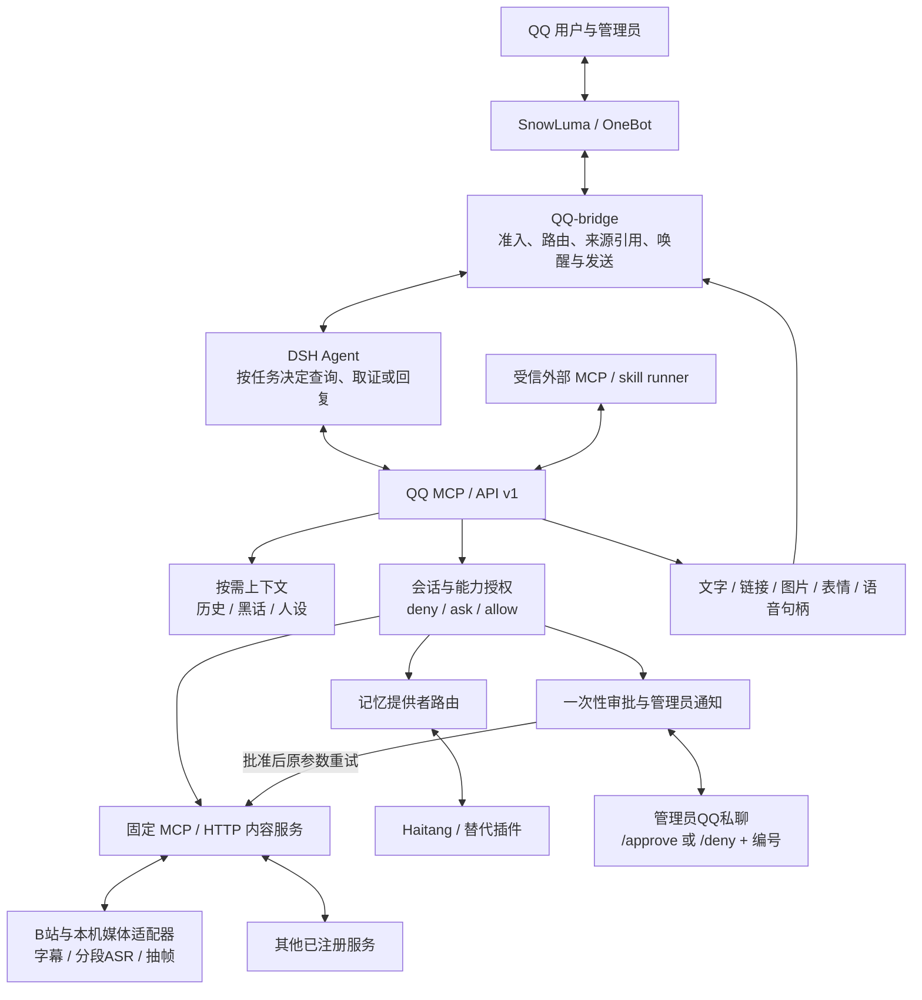

# QQ-bridge-pro：面向 QQ Agent 的开放桥接框架

[English](README.en.md) · [贡献指南](CONTRIBUTING.md) · [详细架构图](docs/guides/FRAMEWORK_ARCHITECTURE.md) · [文档索引](docs/README.md) · [权限规则](RULES.md)

把 QQ 群聊和私聊接入 DeepSeek Harness（DSH），让 Agent 根据任务按需读取上下文、调用内容服务与记忆插件，再通过 QQ 回复。

**本项目基于 [Derpyu520/qq-bridge](https://github.com/Derpyu520/qq-bridge) 扩展开发，结合 DSH、SnowLuma、dsh-video-storyboard、Haitang 等项目的成果。** 原版桥接提供了 QQ 与 DSH 的主链路、聊天模式、工具约束和控制台；本仓库在此基础上补充开放接口、统一内容服务、外部记忆路由、扩展审批和按时间继续取证。上游模块与模型的成果归各原项目，具体见下方“致谢与来源”。

## 当前能力

| 方向 | 已实现内容 |
| --- | --- |
| QQ 收发与路由 | 群聊/私聊会话、未读读取、引用回复、等待、已读水位、白名单和暂停控制；可选双模式隔离管理员任务 |
| 按需上下文 | 二代仿真默认不在每次唤醒时打包黑话、人物印象和聊天快照；按需查询历史、黑话、人设及外部记忆 |
| 开放接口 | 当前会话范围的 API v1、无依赖 `QQBridgeClient`、外部 MCP / skill runner 示例 |
| 内容服务 | 入站内容提供类型与 `sourceId`；Agent 选择已注册的固定 MCP / HTTP 服务，不自动识别全部消息 |
| 视频与动图 | dsh-video-storyboard编号分镜、时间码、字幕与本机转写；分段续看和zoom复查，支持B站、收到的视频与GIF/WebP |
| 语音识别 | QQ语音优先经网关转 WAV，使用本机 SenseVoice；不需要新增云端ASR账户 |
| 语言辅助 | 按需只读草稿检查；已确认黑话优先，未命中时补充通用词典参考。表达风格仍由角色卡控制。[使用说明](docs/guides/LANGUAGE_SUPPORT.md) |
| 统一输出 | 文字、链接、图片、表情包、语音句柄；**尚未接入语音生成/TTS提供者** |
| 开放记忆 | 内置记忆模块由可替换 HTTP / MCP 提供者取代，提供 Haitang 适配器和分会话命名空间 |
| 权限与审批 | 精确会话/能力/数据范围授权、一次性审批、管理员QQ私聊通知、编号批准/拒绝与审计 |
| 业务扩展 | 独立争论辅助任务，由管理员限定群、关注对象、议题、期限及发送方式 |

以上为框架能力，需要按部署配置启用。支持某种接口或输出类型，不代表提供者已经安装；记忆未配置时禁用，不回退到旧内置数组。

## 架构总览



[详细架构文档](docs/guides/FRAMEWORK_ARCHITECTURE.md)包含主链路、按需上下文、审批时序、媒体取证、记忆与业务扩展、Linux部署六张图，以及代码入口和未实现边界。

## 扩展能力入口

| 内容 | 文档 |
| --- | --- |
| 会话令牌、API v1、SDK与外部runner | [扩展接口](docs/guides/EXTENSION_API.md) |
| 消息类型、sourceId、服务注册与媒体输出 | [内容框架](docs/guides/CONTENT_FRAMEWORK.md) |
| 审批、数据范围与一次性许可 | [权限与审批](docs/guides/EXTENSION_PERMISSIONS.md) |
| 视频、动图、语音与运行时安装 | [媒体服务](docs/guides/VIDEO_SERVICES.md) |
| 可替换记忆协议与Haitang安装 | [记忆协议](docs/guides/MEMORY_PROVIDERS.md) / [Haitang适配](docs/guides/HAITANG_MEMORY.md) |
| 管理员限时授权的独立分析任务 | [争论辅助](docs/guides/DEBATE_PLUGIN.md) |
| 群聊仿真与管理员私聊的独立路由 | [双模式](docs/DUAL_MODE.md) |

### 管理员 QQ 审批

1. Agent申请 `ask` 能力时返回 `approval_required`，批准前不读媒体字节、不启动提供者。
2. 桥接向 `ownerQQ` 私聊发送来源会话、能力、脱敏参数摘要和请求编号；相同待审批申请不重复通知。
3. 管理员本人在机器人私聊发送 `/approve 请求编号` 或 `/deny 请求编号`，也可在控制台处理。群内指令及非管理员消息不能审批。
4. **批准不立即执行或自动恢复Agent。** 在原会话让Agent用原来源、原参数和该审批编号继续，许可只消费一次。

默认有效期为申请起5分钟；重启不恢复审批，参数、来源、服务或权限变化会使许可无法复用。通知失败不放行工具。普通 `write/execute` 即使规则为allow仍需审批；明确注册的automatic记忆提供者是独立例外，不授权普通媒体服务。DSH原生工具审批是另一条链路，不能套用扩展审批指令。

### 服务与记忆安装

基础安装不会自动准备视频模型、FFmpeg或第三方源码。先按上述文档准备运行时与固定版本资产，再运行 `npm run setup:media` 或 `npm run setup:memory:haitang`；Linux等平台须提供对应二进制、模型和数据路径。脚本不会自动下载全部依赖。

Haitang适配器复用上游本地存储和词法/模糊检索，不加载宿主自动注入钩子。明确配置 `approvalMode: "automatic"` 后，该提供者的记忆操作可自动授权；这不等于自动保存全部群聊。

外部MCP/skill runner通过当前会话令牌调用API，不应读取桥接配置获取控制台凭据。当前不自动安装MCP、不扫描skills，也没有通用热加载插件系统。


### 外部客户端示例

```js
import { QQBridgeClient } from 'qq-bridge/client';

const client = new QQBridgeClient({
  baseUrl: 'http://127.0.0.1:3100',
  key: currentConversation.key,
  token: currentConversation.token,
  timeoutMs: 190000,
});
await client.contentServices(sourceId);
await client.processContent('bilibili.storyboard', {
  sourceId,
  input: { startSeconds: 120, durationSeconds: 30, cells: 4, need: 'scene' },
});
```

`currentConversation` 由受信宿主提供，`sourceId` 来自实际入站消息；这是接入片段，不是获取凭据的完整脚本。`qq-bridge/client` 用于将本仓库安装/链接为依赖的项目；仓库内也可导入 `./src/bridge-client.mjs`。

## 版本与来源

当前 `package.json` 保留上游基础版本号 **`0.2.0-r4`**，本分支已在 **DSH 0.2.0-rc.2** 上验证。框架改动位于本仓库 **`feature/per-conversation-dual-mode`** 分支，不能假定克隆默认分支就包含这些改动。

DSH使用本机持久化签名密钥建立Cookie鉴权、斜杠RPC和事件流。通常保持 `dsh.authToken` 为空；预设通过bundle patch加载，旧 `~/.dsh/.agent-presets/` 目录机制不再使用。兼容细节与上游历史版本见 [DSH适配说明](docs/guides/DSH_020_ADAPTATION.md)，本说明不是新的上游发行公告。


## 原项目展示

📽️ [原版 qq-bridge：AI 仿真群友介绍视频](https://github.com/Derpyu520/qq-bridge/releases/download/v0.1.5/project-intro.mp4)（约 11 MB）

> 视频改由 **Release 附件**托管，不在仓库里——只想安装桥接的人不必再下载这 11 MB（它此前占整个仓库体积的 88%）。

## 实现与工具边界

- 一个QQ会话对应独立DSH会话；模式或权限变化会撤销旧会话绑定。聊天预设和管理员任务预设分开管理。
- QQ动作通过 `snowluma` 安全MCP子集执行，`snowluma-host` 只读探活；搜索通过 `web-search-safe`。第三方能力走框架注册与授权，不直接给群聊开放宿主工具。
- 提供者通过固定MCP stdio或HTTP入口调用，媒体和记忆结果经过预算与会话检查。进程仍按宿主系统权限运行，不是操作系统沙箱。
- 控制台默认回环监听，令牌未配置时生成并保存到 `state/console-token`。不要向Agent或第三方扩展提供控制台令牌。

## 前置条件

1. 运行中的 DeepSeek Harness Web（默认 `http://127.0.0.1:3080`）
2. 运行中的 SnowLuma，且配置好 OneBot WebSocket 与 HTTP API（默认 `ws://127.0.0.1:3001` / `http://127.0.0.1:3000`，`accessToken` 视配置填写）
3. Node.js：建议使用 24.x LTS（至少 `24.22.1`）；如使用 22.x，至少 `22.23.4`；如使用 26.x，至少 `26.12.1`（Current）。每条主版本线都应使用对应最低修补版本或更新的补丁版本；安装后用 `node --version` 核对。详见 [Node.js 安全基线](docs/guides/SECURITY_BASELINE.md)。

## 安装与配置

```bash
npm install        # 安装依赖（postinstall 会自动修补 @snowluma/sdk 的 ESM 打包 bug）
```

复制 `config.example.json` 为 `config.json` 后编辑：

> Windows CMD 用户请用：`copy config.example.json config.json`

> ⚠️ 真实 `config.json` 与 `state/` 不会进入公开仓库，仓库只提供脱敏的 `config.example.json` 模板。

| 字段 | 说明 |
| --- | --- |
| `dsh.baseUrl` | DSH Web 地址，默认 `http://127.0.0.1:3080` |
| `dsh.provider` / `dsh.model` / `dsh.reasoningEffort` | DSH 会话使用的模型/推理强度；若你的 DSH 没有示例中的模型，改成 DSH 设置页里可用的模型即可（选择失败只打日志，不阻塞启动） |
| `dsh.authToken` | DSH launch token（进程启动凭据）。**通常应留空**：留空时桥接用 `~/.dsh/.credentials.yaml` 里持久化的签名密钥**离线铸造**会话 Cookie，不依赖任何进程期状态（DSH 0.1.7 起启动 token 只存在于内存、日志里那条是上一个进程的陈旧值，换 Cookie 只会 401）。只有显式填了才会优先走 token 交换 |
| `dsh.authHeader` / `dsh.authPrefix` | 保留字段，当前新版 DSH 链路使用 Cookie 交换，不再直接发送该鉴权头 |
| `snowluma.wsUrl` | SnowLuma OneBot **WebSocket** 地址（如 `ws://127.0.0.1:3001`） |
| `snowluma.httpUrl` | OneBot **HTTP API** 地址（如 `http://127.0.0.1:3000`）；不要填 WebSocket 端口，否则会报 HTTP 426 |
| `snowluma.accessToken` | OneBot accessToken，未配置留空 |
| `snowluma.followDiscoveredEndpoint` | 默认 `true`。换 QQ 账号后 token 与端口都会变，桥接会自愈：重新发现并**跟随** SnowLuma 的端点（同时写回 `config.json`）。**想跑第二个实例 / 指向另一份 SnowLuma 安装（多账号、测试）时设为 `false`** —— 那时只自愈 token，绝不动 URL，也不写回 URL。详见「已知行为」 |
| `snowluma.silenceWarnMs` | 上游静默告警阈值（毫秒），默认 `600000`（10 分钟）。已连接但这么久没收到任何事件包（含心跳）时打警告；这只是**提示**，不确定性的判断交给 `good` |
| `snowluma.launcherPath` / `homeDir` | SnowLuma 安装目录（用于 token/端点自发现）。⚠️ 桥接**不会**启动或停止 SnowLuma（见 `LICENSE`） |
| `agentPreset` | QQ 会话使用的 DSH agent preset，默认 `qq-chat`（改性格见下文） |
| `socialV2.agentPreset` | `reserved2` 模式使用的 DSH agent preset，默认 `qq-chat-v2` |
| `socialV2.initialPromptMaxChars` | 会话「初始提示词」（控制台为某个群/私聊预写的环境说明）的字数上限，默认 2000，允许 100~8000。越界值会在启动时收敛并保持原文件不动 |
| `socialV2.media` | 图片/表情的上限：`maxBytes`（单条消息总字节，默认 8MB）、`maxPixels`（单张像素，默认 64MP）、`maxCount`（单条最多处理几张，默认 5）。越界值启动时收敛 |
| `webSearch.provider` | 联网搜索后端：`auto`（默认，优先 DeepSeek、失败回退 Bing）/ `deepseek`（仅 DeepSeek，无凭据时报错）/ `bing` |
| `webSearch.apiKeyEnv` / `apiKey` | 搜索凭据的环境变量名（默认 `DEEPSEEK_API_KEY`）/ 直接写死 key（不推荐）。都不设置时读 DSH 的 `$DSH_HOME/.credentials.yaml` 里同名 ref |
| `webSearch.baseURL` / `model` / `maxUses` / `maxResults` | 搜索端点（默认 `https://api.deepseek.com/anthropic/v1`，必须 https 且解析到公网）、模型（默认 `deepseek-v4-flash`）、单次搜索最多用几次工具、返回条数上限 |
| `workspaceTitle` | QQ 会话在 DSH 界面中的归组名称，默认「QQ 聊天」 |
| `allow.private` / `allow.groups` | 白名单（QQ 号/群号数组）；留空且 `allowAllWhenEmpty: true` 时放行全部 |
| `deny.*` | 黑名单，优先于白名单 |
| `ackMessage` | 消息投递后的立即回复，空字符串关闭 |
| `sendDelayMs` | QQ 连续发送间隔，防止触发频率限制 |
| `consolePort` | 本地控制台端口，默认 `3100` |
| `consoleToken` | 控制台访问令牌；留空时启动自动生成并保存到 `state/console-token` |

> ⚠️ `allowAllWhenEmpty: true` 表示「白名单没填就全部放行」——把 agent 接入 QQ 等于把账号控制权交给了模型，建议先填白名单。

### DSH 端安装（必做：装 preset + 挂 MCP）

桥接和控制台能跑起来还不够，DSH 端还需要安装两个聊天 preset（`qq-chat` / `qq-chat-v2`）并挂载 MCP。**单机新装同样必须执行这一步**（不是只有「另一台设备」才需要），装完还要**重启 DSH**：

```bash
node scripts/setup-dsh.mjs
```

> 全新环境下脚本会把 DSH 默认模式设为 **`reserved2`（二代仿真）**，并创建本地 `state/mode.json` 兜底；这样 AI 使用 `qq_send_message` 等工具收发消息时，DSH 会自动使用 `qq-chat-v2` 模式。如果本机已存在旧的 `state/mode.json` 或 DSH 设置值，脚本会保留不覆盖。之后可在**桥接控制台**（默认 `http://127.0.0.1:3100`）顶部按钮切换模式，控制台会同时写入 DSH 设置与本地兜底文件。

详细步骤见 **[docs/guides/DSH_SETUP.md](docs/guides/DSH_SETUP.md)**。

## 完整启动流程（从零开始）

共6步，先确保DSH可用，再安装桥接并配置已由使用者准备的网关。**第2、3步不可省略**：

1. **DSH**（先安装并运行）
   确认 `http://127.0.0.1:3080` 能打开即可。

2. **装桥接并复制配置**
   ```bash
   git clone --branch feature/per-conversation-dual-mode https://github.com/Cross090525/QQ-bridge-pro.git
   cd QQ-bridge-pro
   npm install
   ```
   Windows CMD 用 `copy config.example.json config.json`，其他平台用 `cp config.example.json config.json`。
   **示例模板里 `allow.private` / `allow.groups` 是空数组**——空白名单 + `allowAllWhenEmpty: false` 时桥接不响应任何消息（这是刻意的 fail-closed 默认值）。白名单在第 5 步填。

3. **装 DSH 端（preset + MCP），然后重启 DSH**
   ```bash
   node scripts/setup-dsh.mjs
   ```
   装完**必须重启 DSH**——preset 与 MCP 只在 DSH 启动时加载。
   跳过这步桥接不会崩，但群聊会话拿不到 `qq-chat` preset，桥接会**拒绝建会话**（有意的安全设计：绝不回退到带 bash/文件工具的默认 preset），表现同样是 QQ 上没反应。

4. **下载并解压 SnowLuma**
   - 下载：<https://github.com/SnowLuma/SnowLuma/releases/latest> 选 `SnowLuma-v<版本>-win-x64.zip`（完整版自带 Node 运行时，Lite 版需本机 Node.js 22.x，至少使用 `22.23.4` 或更新的 22.x 补丁版；两种运行时均须符合 [Node.js 安全基线](docs/guides/SECURITY_BASELINE.md)）
   - 解压到任意目录（例如 `C:\SnowLuma`），双击 `launcher.bat`

5. **首次引导（WebUI）+ 填写桥接配置**
   - 打开启动日志里的 WebUI 地址（README 写的是 `http://localhost:5099`，以你启动日志里实际打印的为准）
   - 用**启动日志中的初始密码**登录，按引导：同意条款 → 设置密码 → 接入 QQ 进程（扫码登录）
   - 在 WebUI 里配置 OneBot 连接：开启 **WebSocket 服务端** 和 **HTTP API**，分别记下**端口**（默认 WS `3001`、HTTP `3000`）和 **accessToken**（若配置了）
   - 回到 `config.json` 填好 `snowluma` 段，并把 `allow.private` / `allow.groups` 换成**你自己的 QQ 号 / 群号**：

     ```json
     "snowluma": {
       "wsUrl": "ws://127.0.0.1:3001",
       "httpUrl": "http://127.0.0.1:3000",
       "accessToken": "你在 WebUI 里配置的 token（没配置就留空）"
     }
     ```

   `wsUrl` 是 OneBot **WebSocket** 端口，`httpUrl` 是 OneBot **HTTP API** 端口（不要填成同一个 WS 端口，否则 MCP 工具会报 HTTP 426）。

6. **启动桥接**
   ```bash
   npm start          # 前台运行（崩溃不自动重启）
   ```
   看到 `SnowLuma 已连接` 即成功；然后 QQ 上给机器人账号发条消息测试。
   Windows 想要「崩溃自动重启」请改用 `start.bat`（见下节）。

## 运行与运维

```bash
npm start          # 或双击 start.bat（守护模式：崩溃自动重启，关闭窗口即停止）
```

**⚠️ 重要**：
- **桥接只能运行一个实例**（有单实例锁，重复启动会被拒绝并提示"已有实例在运行"）
- **用 start.bat 启动**（守护模式），窗口别关——桥接崩溃会在 5 秒后自动拉起
- 桥接异常/消息无反应时：双击 `restart.bat`（自动杀旧实例 → 清理锁 → 重新启动守护）
- **重启 DSH 通常不需要动桥接**：每 5 秒探活，DSH 不可用期间收到的 QQ 消息在桥接进程内排队（最多 50 条/会话，满后丢最旧项），恢复后尝试补投。桥接进程退出会丢失内存队列；断线期间已经结束的回复暂不保证补发。
- 控制台支持的配置可即时更新；手工修改服务/提供者注册后重启桥接。人设保存按当前模式生效；修改预设源后运行 `node scripts/build-agent-preset-patches.mjs` 并重启DSH。不要通过清空状态代替定位问题。

日志示例：

```
12:00:01 [bridge] SnowLuma 已连接：ws://127.0.0.1:3001
12:00:02 [bridge] 新会话 private:12345678 -> sess_xxxx
12:00:02 [bridge] 已投递 private:12345678: 你好
12:00:20 [bridge] agent 回复 (private:12345678) 42 字
```

## 自测（不需要 SnowLuma / QQ）

本地隔离回归（使用临时目录和测试服务，不主动发送QQ消息；媒体/Haitang测试需按对应文档准备外部依赖）：

```bash
npm run test:audit
npm run test:permissions       # 审批通知、私聊指令、一次性许可与隔离
npm run test:context           # 按需上下文
npm run test:framework         # 内容服务接口
npm run test:media             # 需本机媒体运行时与模型
npm run test:memory            # 外部记忆协议
npm run test:memory:haitang     # 需已准备Haitang源码
npm run test:debate            # 独立业务任务
```

reserved2 的 token 开销优化、消息水位协议、升级及回退说明（该专项分析为本地文档，未随仓库发布。）专项离线回归可运行 `npm run test:token`，已包含在上面的完整回归中。

控制台「令牌与花费」看板的账本与价目表回归（峰谷分时、幂等折叠、基线合并、压缩与容错）：

```bash
npm run test:tokens        # 单元测试
npm run test:console-ui    # 离线浏览器回归（含看板渲染与逐轮下钻）
```

本轮审查与修复明细为本地审计文档，未随仓库发布。升级后会为没有权限元数据的历史映射重建一次 QQ 会话；模式或 preset 变化也会自动重建，避免保留旧权限。旧历史仍在 DSH 中。

验证 DSH 侧链路是否打通（会创建一个独立测试会话，不影响现有会话）：

```bash
npm run self-test
```

预期输出：连接成功 → 测试会话创建 → prompt 被接受 → 打印 agent 回复。

## 目录结构

```
qq-bridge/
  config.example.json   # 配置模板（脱敏占位符；真实 config.json 不入库）
  README.md / README.en.md / RULES.md   # 根目录只留这三个文档，其余全在 docs/
  docs/
    README.md           # 文档索引（每篇一句话 + 是否仍然有效）
    FOLDER_MAP.md       # 目录结构与 scripts/ 命名约定
    guides/             # 架构、部署、媒体、外部记忆、审批与运维专题
    DUAL_MODE.md        # 群聊仿真与管理员私聊的独立路由
  audio/                # 语音库：把准备好的音频放这里，可作 QQ 语音发出（用法见 docs/README.md 文档索引）
  dsh/agent-presets/    # qq-chat / qq-chat-v2 的 DSH agent preset 模板
  plugins/qq-mode-console  # DSH 插件：注册 qq-mode 设置命名空间（仅 host 半，UI 卡片未实现）
  integrations/         # 媒体与Haitang提供者适配器
  examples/             # 外部MCP、记忆提供者与业务worker示例
  src/
    core/               # 会话路由、上下文与API映射
    framework/          # 授权、内容服务、媒体句柄与记忆协议
    bridge-client.mjs   # 外部扩展的无依赖客户端
    bridge.js           # 主程序
    dsh-client.js       # Node 版 DSH API 客户端（WS 下行）
    md-to-plain.js      # Markdown → QQ 纯文本
    self-test.js        # DSH 侧自测
  scripts/              # 测试/运维脚本（含 postinstall 的 patch-snowluma-sdk.mjs）
    patch-snowluma-sdk.mjs  # 修补 SDK 的 ESM 打包 bug（postinstall 自动执行）
  state/                # 运行时数据（不入库）
```

> 🎤 **独立语音工具不随本仓库克隆，也不是运行桥接的前置条件**。在部分开发环境中，它是仓库上一级的 `../voice-tool/`（`voice-cli.mjs` /
> `voice-gui.mjs` / `public/voice.html` / `发语音.cmd`）。图形界面双击上一级的「发语音-图形界面.cmd」。
> 它只依赖 SnowLuma，共享内核仍由本仓库 `src/voice-core.js` / `src/snowluma-conn.js` 提供（单一实现）。
>
> ```bash
> cd ../voice-tool
> node voice-cli.mjs status     # 账号/token 自动发现 + 连通性
> node voice-cli.mjs list       # 可发的群聊/私聊 + 语音库
> node voice-cli.mjs            # 交互菜单
> node voice-gui.mjs            # 图形界面（本地小服务 + 浏览器 UI）
> ```

## SnowLuma 版本与上游健康（「连上了但收不到消息」）

「注入」在这个技术栈里只发生在一处：**SnowLuma 用原生组件挂进 QQ 客户端进程**（它自己日志里叫
`[Hook]`，载体是安装目录的 `native/snowluma-win32-x64.{dll,node}`）。**本桥接没有任何原生/注入面**
（依赖全为纯 JS，源码里没有 `.dll` / `.node` / FFI / 进程注入），也不启动、不控制 SnowLuma 或 QQ ——
所以「QQ 注入失败」不可能是本桥接造成的。但**桥接过去无法把这个失败讲清楚**，于是它经常被误报成
「qq-bridge 的问题」。现在桥接会主动把上游健康报出来。

### 已知行为：连上了 ≠ 收得到

SnowLuma 的 `[Hook]` 会退化：它的进程和 OneBot WebSocket **都还活着**，但收不到 QQ 侧的数据。
它自己的日志长这样：

```
WARN [Hook] receive path stale: PID=… UIN=… silentFor=136193ms; reporting good=false
WARN [Hook] process enumeration timed out after 4000ms (worker abandoned)
```

这时桥接这边**一切正常**：WebSocket 通、日志打过 `SnowLuma 已连接`、控制台没有异常，但群里一条消息都不来。
桥接现在对此做两件事：

1. **主信号**：每 30 秒一次的 `meta_event/heartbeat` 载荷里的 `status.good`（SnowLuma 对「QQ → 原生 hook → 我」这条**接收链路**的自评，静默约 105 秒后翻 `false`）。心跳是 SnowLuma 自己的定时器无条件发的，所以这条信号免费且及时，且不需要较新的运行时。
   兜底：每 60 秒问一次 `get_status`（`{online, good}`）。加分项：`bot_status`（账号会话上下线，**SnowLuma 1.14.20 才真的有**）+「距最近一个事件包的时长」（只能证明进程/WS 还活着，**不能**证明收得到 QQ 数据 —— 心跳会一直来）。
   > ⚠️ **不要用 `get_login_info` 取 `good`**：它只返回 `{user_id, nickname}`，而 SDK 不校验 data 载荷 ⇒ 不会报错、`good` 永远是 `null`、这条判断变成永不触发的死代码。（本功能的第一版实现正是这么写错的，回归里已加反面断言钉住。）
2. 判定退化时：日志打**明确指向 SnowLuma `[Hook]`** 的警告、控制台「运行总览」出现 `SnowLuma 上游` 卡片、
   「访问与安全」页出现告警条，`GET /api/status` 的 `snowluma` 字段给出 `degraded` / `good` / `hint`。

排查顺序：控制台看 `SnowLuma 上游` 卡片 → 看 SnowLuma 的 `logs/snowluma-*.log` 里的 `[Hook]` 行 → 再考虑升级 SnowLuma（**升级不换原生组件，见下**）。

### 版本要求

| 组件 | 要求 | 说明 |
| --- | --- | --- |
| SnowLuma **运行时**（QQ 网关本体） | **1.14.20 已实测**（1.14.9 亦兼容） | **实测记录（2026-10-03，SnowLuma 1.14.20 + QQ 在线）**：包 SHA256 与官方发布摘要一致；心跳 `status.good=true`／`interval=30000`；桥接走完「首次 1006 → 自愈 WS token → 已连接」；收到群消息（`lastPacketKind: message/group`）；完整往返成功（唤醒 → DSH 建会话挂 `qq-chat-v2` → 工具发送 1/1 条 → 实际发出两条回复）。 ⚠️ **升级运行时不会更换注入用的原生组件**：实测 `native/snowluma-win32-x64.{dll,node}` 与 `websocket-win32-x64.node` 在 **1.14.9 与 1.14.20 之间逐字节完全相同**（三方对比：官方 1.14.9 包 == 本机安装 == 官方 1.14.20 包），变的只有 `index.mjs`（+414 KB）等 JS 层。所以**升级能带来 OneBot 事件流水线、收发与新区块链路上的修复（`bot_status`、markdown 带 text、事件种类订阅更全），但不会修「原生 hook 挂不上 QQ」这类问题** —— 那种要走 SnowLuma 自己的排查。**升级 SnowLuma 是使用者自己的事**：本桥接只探测、不部署（见 [LICENSE](LICENSE) 与 [RULES.md](RULES.md)） |
| `@snowluma/sdk` / `@snowluma/mcp`（本仓库依赖） | 已钉 `^1.14.20` | 客户端库；OneBot v11 是稳定契约，新库可连旧运行时（本项目实测：库 1.14.20 + 运行时 1.14.9 可正常收发） |
| `bot_status`（账号上下线） | **1.14.20 有；1.14.9 没有** | 逐一核对的只有这两个版本：`bot_status` 在 1.14.9 的 `index.mjs` 里出现 **0** 次、1.14.20 里 **3** 次（带 `sub_type`/`user_id`）。**具体从哪个版本引入未逐版核对**。桥接对老运行时**优雅降级**：订阅不到就只靠心跳 `good` 与 `get_status` |

### 已知行为：HTTP token 与 WS token 是**两个不同的值**

SnowLuma 同一个账号的 **HTTP token（默认 3000 端口）与 WebSocket token（默认 3001 端口）并不相同**
（实测；`snowluma.accessToken` 里通常只能存一个 —— 存的是 HTTP 那个）。因此：

- **桥接每次启动的首次 WS 连接几乎必然失败一次**（日志里 `SnowLuma 连接断开（code=1006）` →
  `SnowLuma 首次连接未成功（将在后台自动重连并尝试自愈 WS token）`），随后自愈重新发现 WS token、
  重连成功，才打出 `SnowLuma 已连接`。**这条序列是正常的，不是故障。**
- 真正会一直连不上的情况：**自愈无从下手** —— `snowluma.homeDir` 没配 / 被移动 / 读不到
  SnowLuma 的 `config/onebot_<QQ号>.json`，或权限不足。这时日志里会有 `token 自愈失败`，
  而 QQ 侧表现为**完全收不到消息**。先确认 `homeDir` 指向真正的 SnowLuma 安装目录。

### 已知行为：端点自愈会覆盖你写的 `wsUrl`

换 QQ 账号后 OneBot 端口与 token 都会变，所以桥接在连不上时会自愈：重新发现 SnowLuma 的端点并
**写回 `config.json`**。这在主场景下是对的，但它不区分「配置里是个过期值」和「你就是要指向别处」——
想跑第二个实例或指向另一份 SnowLuma 安装时会连错账号。要关掉：

```json
"snowluma": { "followDiscoveredEndpoint": false }
```

关掉后**只自愈 token**（换账号仍能恢复），绝不动 URL、也不写回 URL。

## 能力边界与排查

- 视频理解使用dsh-video-storyboard的自适应编号分镜、台词和时间码，仍为抽样证据。普通分镜最多180秒，zoom最多30秒；本机转写时间戳是片段边界，不是逐字对齐。
- 视频总长最多30分钟，默认每张分镜120万像素，cells最多9格；B站纯视频轨下载上限96 MiB、音轨16 MiB，QQ原始媒体8 MiB。下一段仍可能重新下载，完整限制见 [媒体服务](docs/guides/VIDEO_SERVICES.md)。
- 语音识别已实现，但没有接入语音生成/TTS提供者。输出语音句柄和发送已有音频不等于生成语音；现有AI语音发送默认关闭。
- 没有接入夸克视频理解；QQ旧媒体URL可能失效，届时需要重新发送。
- 近期消息缓冲、DSH会话历史、外部长期记忆是三种不同数据。automatic记忆授权不等于自动全量采集聊天。
- 争论辅助需要管理员明确授权并启动独立worker，不自动开启；其任务凭据不会获得通用记忆或媒体权限。见 [争论辅助](docs/guides/DEBATE_PLUGIN.md)。
- QQ无响应时按顺序检查：网关实际收包 → 会话准入/暂停 → 唤醒限频/忙碌 → DSH回合 → 服务授权与结果。个人部署修改过的限额不等于仓库默认值。
- `npm run self-test` 和 `npm run verify:adaptation` 会连接真实DSH；不能视为纯离线测试。真实QQ中的模型行为仍需单独验收。
- 提供者按宿主系统权限运行；MCP协议和会话隔离不是操作系统沙箱。凭据、模型账户、真实配置、私人聊天和记忆数据不要提交到版本库。

## 合规提醒

SnowLuma 是独立第三方项目，与腾讯/QQ 无隶属关系，仅供学习与技术研究；使用前请阅读其 EULA 与《QQ 用户协议》。


## 致谢与来源

本框架结合多个项目的成果。上游作者和社区提供了桥接、Agent运行时、QQ网关、视频提取、记忆检索和语音识别的基础能力；本仓库围绕QQ场景做接口适配、权限与流程整合。

| 项目 / 社区 | 贡献与本仓库使用方式 |
| --- | --- |
| [Derpyu520/qq-bridge](https://github.com/Derpyu520/qq-bridge) 及原贡献者 | 本仓库的直接基础：QQ↔DSH主链路、聊天模式、预设守卫、控制台、角色、黑话与表情功能。保留原作者署名和版权信息 |
| [DeepSeek Harness](https://github.com/deepseek-ai/deepseek-harness) | Agent运行时、模型会话、工具调用、预设和事件流；本仓库适配其接口 |
| [SnowLuma](https://github.com/SnowLuma/SnowLuma) 与 OneBot 生态 | QQ接入、HTTP/WebSocket消息协议、媒体与发送能力；本仓库连接已运行网关 |
| [SAOS-3624/dsh-video-storyboard](https://github.com/SAOS-3624/dsh-video-storyboard) | 当前视频理解的分镜、镜头检测、清晰帧选择与时间轴实现（Apache-2.0） |
| [CZX2244/dsh-bilibili](https://github.com/CZX2244/dsh-bilibili) | 历史视频提取方案的来源；当前运行时已移除该依赖 |
| [haitang1/dsh-memory](https://github.com/haitang1/dsh-memory) | 复用 `lib/store.js` 的本地存储与词法/模糊检索；本仓库增加统一协议与分会话命名空间，不加载宿主自动注入钩子 |
| [FFmpeg](https://ffmpeg.org/) / ffprobe | 媒体探测、解码、抽帧与音频格式转换 |
| [SenseVoice](https://github.com/FunAudioLLM/SenseVoice)、[sherpa-onnx](https://github.com/k2-fsa/sherpa-onnx)、[ONNX Runtime](https://onnxruntime.ai/) | 语音识别模型、推理接口与运行时；本仓库补充分段调度和QQ语音适配 |
| [Model Context Protocol SDK](https://github.com/modelcontextprotocol/typescript-sdk) 及其他依赖维护者 | MCP协议实现与基础库，支撑外部服务接入 |

**本仓库新增工作**：会话范围API与客户端、按需上下文路由、内容服务注册与授权、管理员QQ通知及一次性审批、记忆提供者协议、媒体时间窗口与分段取证、集成测试及文档。模型、推理引擎、QQ网关和上游提取/检索模块的成果归各原项目。

本仓库沿用 [MIT许可证及原版权声明](LICENSE)。第三方源码、模型、二进制和服务各自保留原许可与使用条件，不因接入本框架而变更。SnowLuma本体与媒体模型/运行时不随本仓库分发；请保留各项目的署名、许可证及来源记录。
