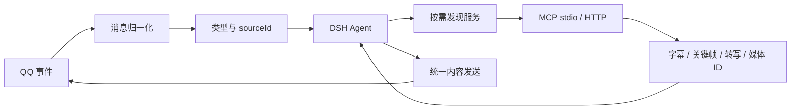

# QQ 内容与服务开发框架

框架托管的扩展现已接入默认拒绝、会话授权与一次性审批，使用方法见 [扩展授权与审批](EXTENSION_PERMISSIONS.md)。完整后续范围见 [权限设计](EXTENSION_PERMISSIONS_DESIGN.md)。注册服务不会自动获得调用权限。

记忆作为独立的 [开放提供者接口](MEMORY_PROVIDERS.md) 整体替换内置模块，复用权限与传输层；不再把记忆数据库或算法放在 bridge.js 中。

本分支把 QQ 接入、消息类型、内容处理服务与输出分开。服务通过配置接入，不需要把每个视频/语音供应商写进 bridge.js。识别与合成由 **Agent 按需选择**，收到消息不会自动下载视频、转写音频或调用模型服务。



## 框架目前负责什么

| 层 | 文件 | 职责 |
|---|---|---|
| 输入与输出协议 | `src/framework/content.mjs` | 识别 text/link/image/voice/video/file/sticker，解析 QQ JSON/XML 分享卡片中的 URL；生成会话范围资源引用；校验输出 |
| 媒体 | `src/framework/media-store.mjs` | 有大小/类型校验的临时图片、表情与音频；用媒体 ID 代替任意文件路径 |
| 内容服务运行时 | `src/framework/services.mjs` | 按输入类型/域名发现服务、按需启动 MCP、HTTP 调用、参数映射、超时/并发/缓存与结果归一化 |
| QQ 与 DSH 适配 | `src/bridge.js` | 会话鉴权、持久来源索引、受限媒体读取、现有 QQ 发送/限流/暂停与 Agent 消息流 |
| 外部客户端 | `src/bridge-client.mjs` | 服务发现、处理、媒体上传/读取、统一发送 |

当前路径覆盖二代仿真与双模式管理员私聊。管理员只处理自己收到的内容并回复本人，不能借内容接口读群聊记忆。普通 chat/一代仍保留其原来的控制逻辑。

## 输入协议

未读消息新增 `content` 数组，举例：

```json
[
  { "type": "text", "text": "看看这个视频，评价一下" },
  { "type": "link", "sourceId": "32位十六进制引用", "platform": "bilibili", "url": "https://www.bilibili.com/video/BV...", "label": "链接" },
  { "type": "voice", "sourceId": "另一资源引用", "label": "voice" }
]
```

模型会看到类型和引用，不会收到网关缓存路径。相同消息中的 URL 会去重；B 站主站/子域与 b23.tv 标记为 bilibili。链接分类不是视频内容理解：标题、简介、字幕、画面分别属于不同证据。

`sourceId` 只能指向当前会话实际收到的内容；索引保存在 `state/content-sources.json`，最多 1000 项，来源引用 24 小时过期。索引损坏时不覆盖原文件，新引用暂存内存。引用查询不会确认消息已读。

## Agent 的三个统一工具

1. `qq_content_services(key, token, sourceId?)`：按需查看可用服务；传 sourceId 时按类型和域名筛选。
2. `qq_process_content(key, token, serviceId, sourceId?, input?)`：调用服务；语音/视频等指定来源，文字合成使用 `input.text`。
3. `qq_send_content(key, token, content)`：发送一种明确类型的内容。

模型只预先看到这三个工具，不需要把所有第三方服务的完整工具 schema 加入每一轮上下文。MCP 子服务在第一次实际调用时才连接，连接复用到 bridge 退出；HTTP 服务只在调用时收到请求。服务注册信息由管理员配置，群消息和工具参数不能修改注册表或执行命令。

对于 B 站：Agent 先读链接引用，选择视频服务，得到字幕/关键帧等，再自行评价。只有元数据时应说明“根据标题/简介”；字幕/抽帧也不代表看过整段视频。服务未配置、登录失败、无字幕或超时都应该如实反馈。

## 接入一个服务

把 `examples/content-services.example.json` 中需要的 service 条目合并到实际 config.json 的 `framework.services`，修改真实命令/地址后重启 bridge，再在控制台为指定会话配置权限规则。示例里的路径与端口是占位符，**不是已经安装的视频、ASR 或 TTS 服务**。

MCP 示例：

```json
{
  "id": "bilibili.inspect",
  "effect": "read",
  "description": "读取视频字幕和关键帧",
  "accepts": ["link"],
  "hosts": ["bilibili.com", "b23.tv"],
  "transport": { "type": "stdio", "command": "node", "args": ["C:/services/video-mcp.mjs"] },
  "tool": "bili_video_digest",
  "arguments": { "url": "$source.url", "frames": 4 },
  "timeoutMs": 120000
}
```

服务注册表只告诉框架怎样调用现有服务，不提供视频提取算法。本例将来源中的 URL 映射到第三方工具的 url 参数。无需把该服务额外安装到 DSH 或放宽 DSH 的工具前缀：由桥接内的受控服务运行时调用指定工具。外部 MCP 直接连接 DSH 的方式也仍可用，见 [EXTENSION_API.md](EXTENSION_API.md)。

参数映射只支持 `$source.<字段>` / `$input.<字段>`、常量与 JSON 数组/对象，不执行代码。可用 source 字段为 sourceId、type、messageId、可用时的 url/platform；`inputMode: "bytes"` 会额外提供 data（base64）、mimeType 与 bytes。

可在服务中增加 `inputHint`（最多 500 字符）说明 Agent 应传哪些 input 字段；服务发现会返回该提示。完整业务参数仍由对应服务校验。

HTTP 服务注册示例：

```json
{
  "id": "voice.transcribe",
  "effect": "read",
  "accepts": ["voice"],
  "inputMode": "bytes",
  "transport": { "type": "http", "url": "http://127.0.0.1:9871/transcribe" }
}
```

无 arguments 映射时，框架 POST `{ "source": {...}, "input": {...} }`。服务应返回 MCP 风格结果：

```json
{
  "content": [{ "type": "text", "text": "识别出的实际文字" }],
  "evidence": ["audio", "transcript"]
}
```

返回图片使用 `{type:"image", mimeType:"image/png", data:"base64..."}`，可以作为关键帧直接交给视觉模型。返回语音使用 `{type:"audio", mimeType:"audio/wav", data:"base64..."}`，框架保存为媒体 ID，Agent 再决定是否发送。支持 WAV/MP3/Ogg/FLAC 与 PNG/JPEG/GIF/WebP；内容与声明格式必须对应。

`evidence` 可为 metadata/transcript/frames/audio/video 数组；这是提供者的声明，框架无法替提供者证明视频已完整观看。没有声明时返回明确提示，Agent 仍需根据实际内容判断。

HTTP 凭据通过 `transport.headersFrom` 从环境变量取得，例如 `{"Authorization":"VIDEO_SERVICE_AUTH"}`；环境变量的值应是完整请求头值。stdio 使用 `transport.envFrom`，例如 `{"API_KEY":"MY_ASR_KEY"}`。发现接口不会暴露这些配置，框架不向服务发送 bridge 的会话令牌或控制台令牌。

外部 skills 可由自己的 runner 包装成上述 HTTP/MCP 服务，例如参数映射 `{"skill":"video-review","url":"$source.url"}`。bridge 不负责执行任意 skill 文件。

## 输出协议

```js
await client.sendContent({ type: 'text', text: '从字幕看，作者主要在讨论摄影。' });
await client.sendContent({ type: 'link', title: '原视频', url: 'https://www.bilibili.com/video/BV...' });
await client.sendContent({ type: 'sticker', stickerId: '来自 qq_list_stickers 的 ID' });
await client.sendContent({ type: 'voice', mediaId: synthesisResult.media[0].mediaId });
await client.sendContent({ type: 'image', mediaId: imageResult.media[0].mediaId });
```

也支持语音库文件名 `{type:"voice",voice:"晚安.wav"}`。生成的图片可按 `{type:"sticker",mediaId}` 发送为表情；表情仍是一张单独气泡。文字/链接复用原有文本发送流程，表情库引用复用原有表情发送，语音复用原有音频检查与编码链路。原内置收发工具仍可继续使用。

语音发送需同时启用 `socialV2.voice.enabled` 与 `socialV2.tools.sendVoice`；统一发送开关为 `contentSend`，识别开关为 `contentServices`。服务能生成媒体不等于已向 QQ 发送。

## 新 HTTP/SDK 接口

沿用 v1 的当前会话令牌鉴权，不需要控制台令牌：

| 方法 | 路径 | 客户端方法 |
|---|---|---|
| GET | `/api/v1/content/services?sourceId=...` | `contentServices(sourceId?)` |
| POST | `/api/v1/content/process` | `processContent(serviceId, {sourceId,input})` |
| POST | `/api/v1/content/send` | `sendContent(content)` |
| GET | `/api/v1/media/read?sourceId=...` | `readMedia(sourceId)` |
| POST | `/api/v1/media/upload` | `uploadMedia({mimeType,data})` |

上传/服务生成的媒体位于受保护的 `state/framework-media/`，媒体 ID 绑定当前会话令牌的摘要，不能跨会话或换令牌使用；不混入共享语音库。有效期 1 小时、单项最多 8MB、总量 64MB/128 个活动句柄；过期文件按严格的生成文件名回收。媒体句柄在 bridge 重启后失效，旧文件会按有效期回收。

网关媒体的 bytes 读取最多 8MB，公网下载复用 DNS/IP 固定及重定向校验。无可下载 URL 的语音可尝试网关 get_record；网关返回本地文件时，只能读取明确配置的 `framework.mediaRoots` 内文件，不默认开放整个 SnowLuma 安装目录。配置应只包含媒体缓存目录。视频通常通过 URL 交给服务读取字幕、抽帧或转写，8MB 限制不表示支持直接传入任意长视频。

运行时最多同时处理 4 个请求，默认超时 60 秒、上限 180 秒。相同输入的在途请求拒绝重复执行；授权的 read/generate 小型纯文本结果缓存 5 分钟，最多 64 项，缓存命中仍检查权限并计入额度；write/execute 与包含媒体的结果不缓存。可以 `cache:false` 禁用结果缓存。HTTP 响应上限 12MB，工具结果最多 12 项、文本 16000 字符、媒体合计 8MB。

MCP 连接关闭后，下次显式调用会重新连接；不会自动重放已失败的业务调用。

暂停仿真、会话撤销、工具开关变化与发送队列都继续检查身份；返回数据和发送媒体前重新验证。工具超时不会自动重试，也不保证撤销第三方已经发生的计算或副作用。

## 运行边界与验证

管理员注册的服务是受信代码。服务自己的文件权限、模型凭据和网络访问由其宿主管理；如果按 reference 把 URL 交给服务，提供者必须自行处理 DNS/重定向/大小限制，bridge 的安全下载保护不覆盖提供者的网络请求。建议用 hosts 限制单个平台服务。

`npm run test:framework` 用假 QQ/DSH、真实本机 HTTP 和 stdio MCP 连接验证：类型归一化、B 站调用参数映射、按需调用、语音识别字节传递、TTS 媒体句柄、统一输出、跨会话隔离、缓存、超时和撤权。测试服务只返回 fixture 字幕与测试波形，**没有访问真实 B 站，也没有验证真实 ASR/TTS 质量**。实际使用需配置相应提供者并联调。
