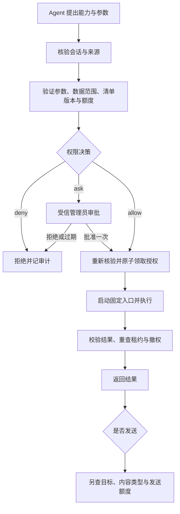

# MCP 与 skills 调用权限设计

状态：总体设计规范。框架托管服务与媒体读/上传已实现会话授权、默认拒绝、一次性审批、控制台与审计，详见 [已实现的使用约定与边界](EXTENSION_PERMISSIONS.md)。扩展凭证、可信用户意图、skill 子步骤代理与所有 DSH 工具的统一拦截尚未实现；下文是目标设计，不能把整个文档视为已完成。

## 当前边界与缺口

原有会话令牌、来源引用、媒体句柄与发送检查可限制跨会话使用；服务命令和地址只能由管理员配置。框架服务现增加独立会话授权，仿真预设的额外直连 MCP 白名单已关闭以防审批旁路。管理员标准 DSH 工具与外部 runner 的完整会话 API 凭证仍未统一到最终的最小权限策略。

“Agent 判断是否有必要”只负责提出调用意图，不代表授权。注册服务、发现服务、启动服务、执行业务、读取数据、发送结果必须分别检查权限。管理员私聊也不能因为 owner 身份自动获得所有扩展能力。

## 核心原则

1. 默认拒绝。安装或注册扩展不授予任何会话调用权；缺少声明、找不到策略、策略损坏、审批服务不可用均不执行。
2. 按能力授权，不按整个 MCP server 或 skill 包授权。例：允许视频字幕读取不允许同一服务的评论发布；允许某个 skill 工作流不等于允许任意 shell。
3. 权限由管理员配置与受信审批通道决定。群成员请求、Agent 参数、skills 文本和工具返回值不能扩权。
4. 执行端强制检查；隐藏工具 schema 和提示词只作为辅助。
5. 能力声明包括数据与副作用。只读操作也可能传输私密媒体、使用凭据或产生费用，不因“只读”而默认放行。

## 身份与授权对象

每次调用由宿主生成不可由模型覆盖的身份：会话 key、会话租约摘要、模式、Agent 身份。若绑定用户请求，额外记录网关证实的 messageId、senderId 和来源引用。无法证实明确用户请求时，触发类型只能视为 autonomous。

授权粒度为“会话 + 能力 ID + 触发方式 + 数据范围 + 额度”。同一群授权不传播到其他群，也不传播到管理员私聊。会话模式切换、重建或撤权使旧审批失效。

扩展清单至少声明：

| 字段 | 含义 |
|---|---|
| capabilityId / version | 固定业务能力及版本 |
| transport / tool / entrypoint | 受信注册的固定执行入口 |
| effect | read / generate / write / execute；未知按 execute 处理 |
| inputSchema / outputSchema | 严格的业务参数和结果校验；拒绝额外字段 |
| dataScopes | public-link、current-source、current-session-history 等明确数据范围 |
| destinations | 允许的服务端点、外部平台或接收目标 |
| credentialRef | 管理员配置的凭据引用，不向 Agent 暴露密钥 |
| limits | 次数、并发、超时、输入/输出体积及费用上限 |
| manifestDigest | 包含入口、参数映射、数据范围、凭据引用与版本的摘要 |

模型不能指定 command、工具名、skill 路径、凭据或任意回调地址。第三方清单的 effect 是声明，管理员仍需审核代码和授予权限。

## 三种调用决策

| 决策 | 行为 |
|---|---|
| deny | 不暴露可用能力，不启动进程，不读取媒体，不连接服务 |
| allow | 仅在精确授权范围内由 Agent 按需调用，仍受数据和额度限制 |
| ask | 创建待审批请求，不启动服务、不外传参数；批准后允许同一请求执行一次 |

拒绝规则优先，未命中规则为 deny。规则不得用任意能力通配符授予 write/execute；显式永久 allow 仅适用于经管理员审核的 read/generate。外部写操作与执行操作至少 ask，管理员也可完全 deny。

建议默认行为（这些不是内置授权）：

| 场景 | 建议策略 |
|---|---|
| 读取公开 B 站链接的字幕与关键帧 | 对指定群、指定视频能力授予受额度限制的 allow |
| 识别当前会话收到的语音 | 本地服务可定向 allow；传到外部服务需单独授予媒体外传权限 |
| 用本次回复文字合成语音 | 指定 TTS 服务、字数和费用限制内 allow |
| 导出聊天记录、把历史交给外部模型 | 默认 deny，需要明确的数据授权；不能因能读历史就推导可外传 |
| 发 QQ 回复 | 独立的当前会话发送权限，与生成/识别权限分开 |
| 发布 B 站评论、修改文件、启动其他程序 | 默认 ask 或 deny，不能继承视频读取权限 |
| 动态安装 MCP、加载未知 skill、任意 shell | 默认 deny，只能走管理员管理通道 |

部署需先配置真实服务，审核其数据去向与成本，然后授予上述具体权限；不能因为用户说“看看这个”就允许上传整个会话历史。

## 调用状态机

必须在下载源文件、启动 stdio 进程、连接 HTTP 服务之前完成审批。缓存命中也先检查当前授权；缓存键包含会话租约、能力/策略摘要和参数。服务结果不能触发绕过策略的后续调用。

自发任务与用户触发任务可使用不同规则。模型填入 reason、userRequested 或“用户已同意”都不算授权证据。用户触发限制需要由可信入口绑定请求；第一版无法可靠识别意图时应回退 ask，而不是让模型自己签发授权。

## 审批契约

审批请求绑定：requestId、会话租约、能力/清单/策略摘要、规范化参数摘要、来源引用与内容摘要、数据目标、额度上限、有效期。

审批界面应显示具体动作、参数、来源、是否上传媒体/历史、目标服务、费用上限及副作用，给出允许一次/拒绝。纯模型理由不足以支撑批准；管理员应能展开查看实际请求内容。显示文本作为不可信数据转义，不执行服务返回的页面内容。

批准不立即扩大权限，不签发通用会话令牌；只生成该精确请求的单次许可。任意参数、目标、服务版本、来源内容或权限策略变化都需要重新审批。默认有效期 5 分钟；过期、重启、撤权和换会话后不可使用。领取许可与登记执行须原子完成，并发和重试不可重复消费。写操作失败时不自动重放。

审批 API 仅供管理员控制台身份使用，不加入公开 v1 路由，不注册成 Agent 工具。群聊里由模型生成的“同意”以及普通成员发送的同意均不能批准。若未来支持 QQ 审批，必须通过网关验证 owner senderId、私聊目标及一次性挑战，不依赖正文自报身份。

## MCP、skills 与旁路

- 框架托管 MCP：serviceId 映射到固定 tool，所有执行经过权限代理；Agent 不直接获得同服务器其他工具。
- skills：skill 是工作流说明，不是权限。只能由已登记的 runner 执行固定入口；每个下游动作仍需校验，skill 权限为宿主授权与该流程声明的交集。
- 直接挂到 DSH 的外部 MCP：静态工具名白名单只适合管理员明确授予的低风险能力，不能表示 ask、数据范围或单次审批。需要上述策略的扩展必须经过代理，不再额外直连同一执行入口。
- 外部 runner 调用 API：现有完整会话令牌不是最小权限凭证。后续需引入绑定会话/能力/路由/有效期的扩展凭证；不应直接把完整会话令牌交给不受信第三方。
- 管理员标准 DSH preset 仍可能具有自己的本地工具。仅实现 framework 的闸门不能声称约束整个 DSH；若要统一管控，需在宿主层增加同样的执行拦截或使用专门的受限 preset。

任何受信服务启动后仍具有宿主提供的权限。bridge 的清单校验不等于操作系统沙箱；实际文件/网络隔离需由容器、受限用户、挂载目录与网络策略实现。runner 内部无法被观察的动作不能声称已逐项授权；此类服务必须整体按其最高副作用审核，或拒绝接入。

## 审计与撤销

记录时间、会话、能力版本、决策、审批人、参数摘要、数据类别/目标、执行结果、耗时、额度消耗及拒绝原因。默认不写明文聊天、音频、令牌、Cookie 或服务密钥。审批详情属于受保护管理数据，设置有界保留期。

管理员可撤销会话能力、待审批请求或单次许可。执行前与结果/发送前重查；已发生的外部副作用无法保证撤销，必须在审批中说明。第三方拒绝取消或无法中断时，阻止继续使用结果和执行后续动作。

## 实施顺序与验收

1. 能力清单与会话策略：默认 deny，发现过滤，执行前检查；覆盖缓存、媒体读取与输出旁路。
2. 管理端逐次审批：精确请求绑定、单次消费、过期/撤销、可审阅界面。未完成时 ask 必须阻断，不能临时当成 allow。
3. 扩展凭证与 runner 约束：限制 API 路由、数据、目标与额度，收口直接 DSH 工具旁路。
4. 提供 read/generate 的审核后模板及联调示例；禁止模板隐含安装即授权。

验收至少包含：未授权不启动/下载/联网；跨群与 owner 不继承授权；相同 MCP 的未授予工具被拒；审批参数替换、过期、撤销、重放和并发双花被拒；缓存不能绕过撤权；外传历史与生成后发送需独立权限；服务结果中的提权指令无效；skill 子调用不扩权；额度到达后拒绝；管理审批接口不能被 Agent 调用。应使用真实本机 HTTP/stdio 协议和模拟 QQ/DSH 完成边界测试，再进行真实服务联调。
