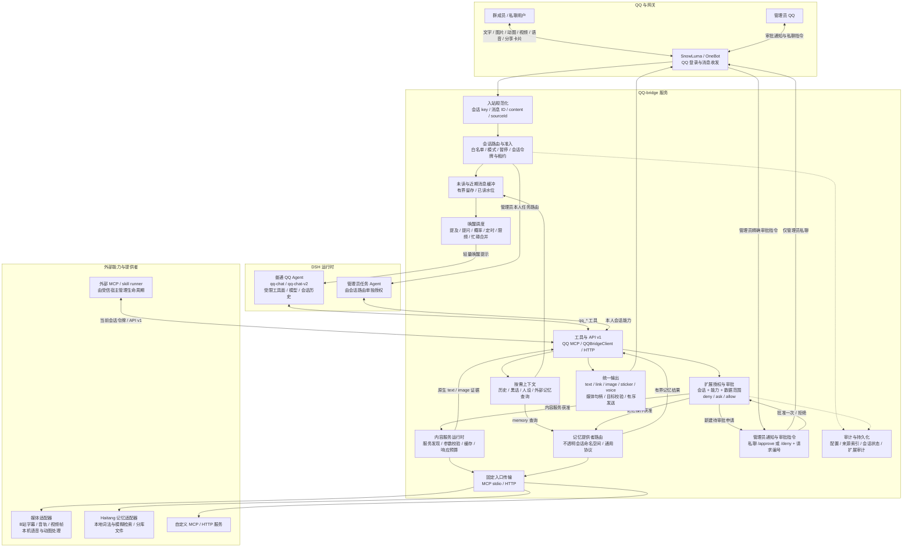
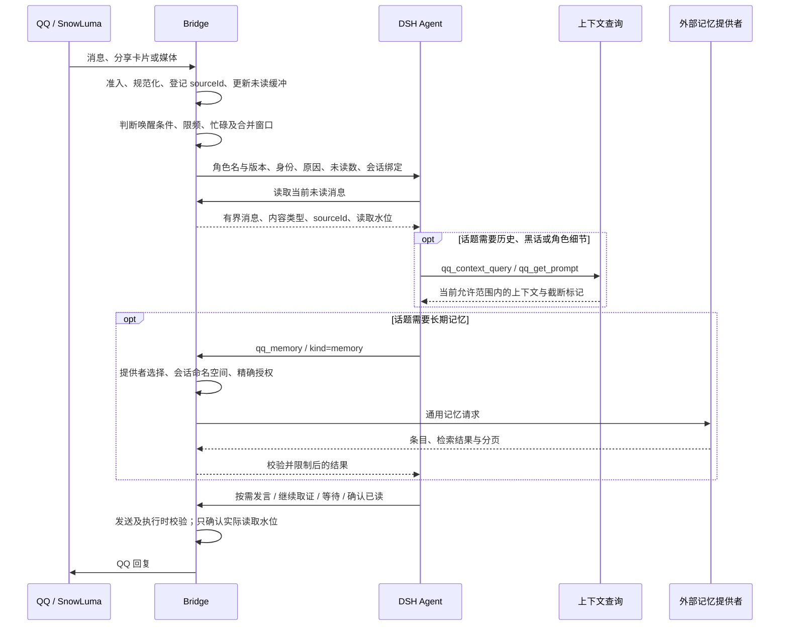
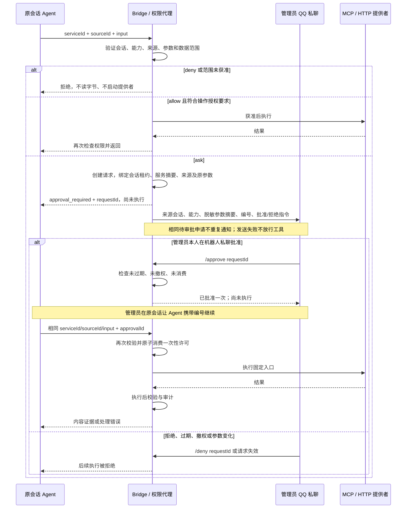
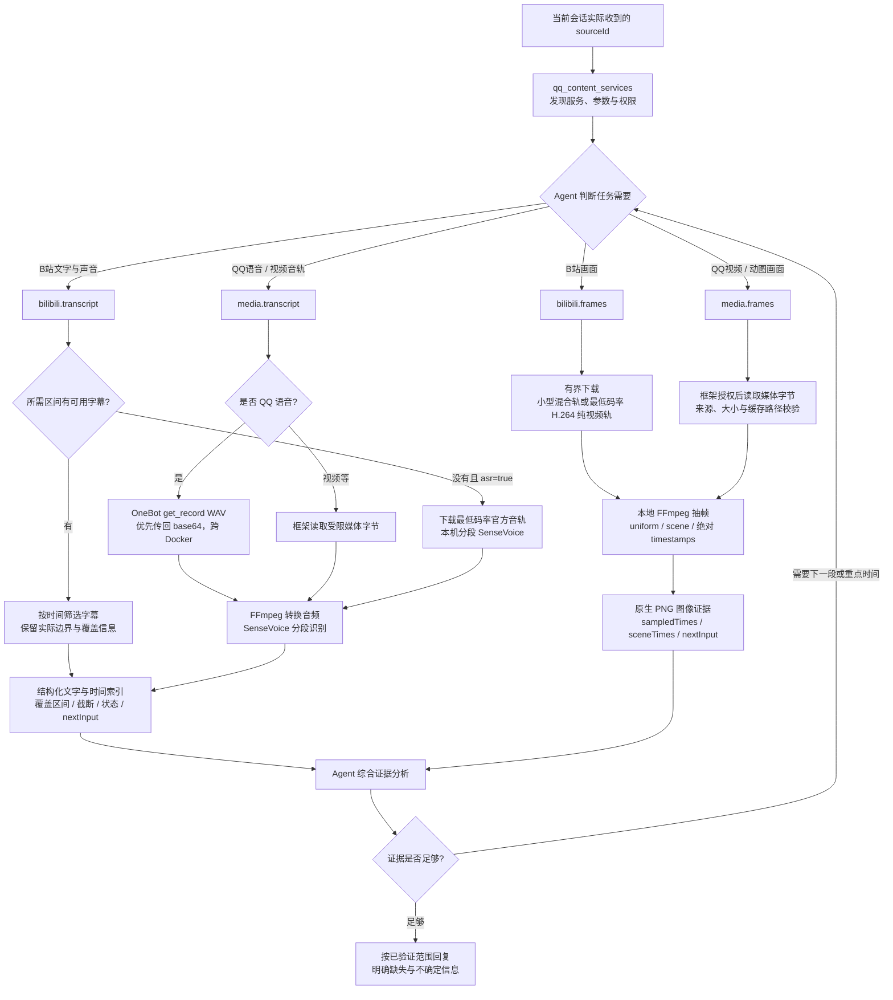
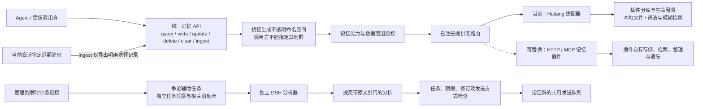
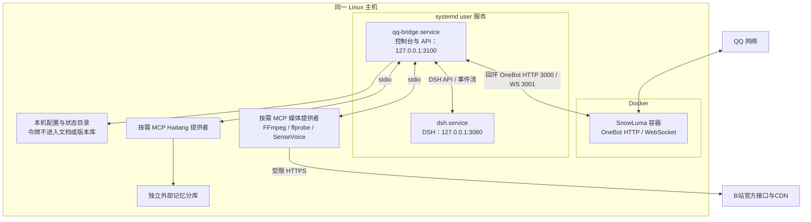

# QQ-bridge 开放框架架构

按当前实现整理，更新于 2026-10-25。本文区分框架能力、部署配置和未实现功能；不是未来功能清单。相关代码版本：媒体分段取证 `d0e6fff`、管理员QQ审批通知 `5561b2f`。

## 1. 总体分层与主调用链

箭头表示逻辑调用方向，不表示所有模块都在独立进程中。桥接的路由、权限、来源索引、服务运行时和输出主要位于同一 Node 进程；MCP stdio 提供者是按需启动的独立进程。

框架开放的是协议和注册接口：外部 MCP / skill runner 可以使用受限客户端调用桥接，管理员也可以注册固定 MCP / HTTP 内容服务。当前没有通用热加载插件系统，也不会自动安装或扫描任意 skills。

## 2. 按需上下文与消息生命周期

- `reserved2` 默认 `on-demand`，不在每次唤醒时附加人物印象、黑话和聊天快照。首次唤醒仍可带管理员编写的会话环境。
- 人设不是每轮全量重复注入：首次、版本变化或压缩后缺失时读取。普通聊天和一代仿真的角色注入仍沿用既有行为。
- 近期消息和未读是有界缓冲，不是完整聊天档案。DSH 自己的会话历史与记忆提供者的数据是不同的存储。
- 没有提供者时记忆禁用；不回退到旧内置记忆数组。自动记忆授权不等于自动保存全部群聊。

## 3. 扩展审批、管理员通知与执行时序

- 默认从申请起5分钟有效，重启不恢复。批准不自动启动服务、不自动唤醒原会话，也不扩大长期权限。
- 私聊审批由桥接解析，不经过语言模型；群内命令及非管理员消息不能批准。控制台审批接口仍可使用，Agent 凭据不能管理审批。
- 普通内容服务的 `write/execute` 等副作用即使规则为 allow 仍需审批；本机自动记忆是明确注册的独立例外，不能被普通服务冒用。
- 通知只带有界脱敏摘要，完整参数、来源和执行入口可在控制台审阅。通知或网络失败不会把 ask 变成 allow。

## 4. 视频、动图与语音取证

分段转写默认0–120秒、每段30秒，单次区间最多180秒。场景检测使用每秒2帧、64×36画面的颜色直方图变化候选，按时间分箱选帧并均匀补齐；不是语义镜头识别。绝对时间点可检查动作或争议片段前后。

转写时间戳是片段边界，不是逐字对齐。部分失败保留成功片段，以 `partial` 与 `nextInput` 继续；截断需缩小时间区间重查。抽样帧不能代表完整观看，纯视频轨没有音频不能推断原视频静音。

下载先经过主机、DNS/IP、端口、重定向、体积和超时检查，FFmpeg 只读取已下载本地文件。B站Cookie不发送给CDN。当前后续调用可能重新下载视频，尚无跨调用原始媒体缓存。

## 5. 记忆与业务扩展边界

当前 Haitang 的查询、增删改、清空与指定记录导入使用 automatic 授权；显式 deny/ask、会话准入、额度和审计仍有效。没有启用宿主全量采集、云端向量检索或自动摘要钩子。

争论辅助是独立业务扩展示例，不是所有普通聊天都进入该流程。只有管理员创建并授权的有效任务生效；自动发送不受争论专属冷却或条数限制，但不绕过任务检查或QQ平台限制。其凭据不能调用通用媒体、记忆和管理接口。

## 6. 当前 Linux 部署

Docker 内的 QQ 语音优先通过网关转成 WAV 字节传给桥接，不依赖暴露账号目录。只返回容器路径的旧网关仍需明确共享缓存与路径映射。外部访问回环控制台需要受信隧道等部署方式，不能假定3100端口已对局域网开放。

2026-10-25 当前部署快照：唤醒额度已改为每分钟2次、每小时120次；其余额度未随此次修改。测试群 `bilibili.frames` 的临时 ask 已恢复为测试前 allow。这里记录的是部署状态，不修改仓库代码里的默认值，也不发布私人会话号、令牌或运行配置。

## 7. 代码与接口索引

| 责任 | 主要入口 |
| --- | --- |
| QQ 入站、唤醒、工具接口、发送、管理员私聊审批 | `src/bridge.js` |
| 双模式与会话路由 | `src/core/dual-mode.mjs`、`src/core/session-router.mjs` |
| 按需上下文与 API 映射 | `src/core/context-query.mjs`、`src/core/public-api.mjs` |
| 来源引用与媒体句柄 | `src/framework/content.mjs`、`src/framework/media-store.mjs` |
| 精确授权、一次性审批与通知事件 | `src/framework/permissions.mjs` |
| 内容服务发现、执行与响应预算 | `src/framework/services.mjs` |
| 固定 MCP / HTTP 传输 | `src/framework/service-transport.mjs` |
| 开放记忆协议及旧入口兼容 | `src/framework/memory-providers.mjs`、`src/framework/memory-compat.mjs` |
| Haitang 适配器 | `integrations/haitang-memory.mjs` |
| 媒体服务声明与B站适配 | `integrations/media-services.mjs`、`integrations/media-provider.mjs` |
| 抽帧、音频转换与识别 | `integrations/media-engine.mjs`、`integrations/media-asr-worker.mjs` |
| 外部 MCP / skill runner 客户端 | `src/bridge-client.mjs`、`examples/` |
| QQ Agent 约束与模型指引 | `dsh/agent-presets/`、`plugins/qq-agent-presets/` |
| 争论任务与插件客户端 | `src/framework/debate.mjs`、`src/debate-client.mjs` |

详细协议见 [扩展API](EXTENSION_API.md)、[内容框架](CONTENT_FRAMEWORK.md)、[权限审批](EXTENSION_PERMISSIONS.md)、[视频服务](VIDEO_SERVICES.md)、[记忆提供者](MEMORY_PROVIDERS.md) 和 [争论辅助](DEBATE_PLUGIN.md)。

## 8. 尚未实现的部分

- 没有接入夸克视频理解；试验已停止。
- 没有语音生成/TTS提供者。统一输出支持语音句柄，已有本地语音发送能力，不等于已实现生成语音。
- 没有连续视频多模态理解：当前是字幕/分段ASR与抽样画面组合。
- 批准不会自动恢复 Agent 回合；需要原会话用原参数携带审批编号继续。
- 外部进程的系统权限由部署宿主管理。MCP协议和桥接会话隔离不是操作系统沙箱。
