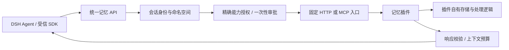

# 整体开放的记忆提供者接口 v1

本版替换桥接原有内置记忆模块。桥接只提供提供者路由、会话身份、输入/输出协议、权限审批和结果预算；记忆的存储、检索、摘要、合并、遗忘与过期策略由插件实现。不绑定向量库、模型供应商或具体记忆产品。

默认没有记忆提供者。未配置或提供者不可用时明确报错，不回退到旧 activeTopics / pendingThoughts / memberImpressions。原有字段不再装入运行时，不再写入 social-v2.json，也不再影响唤醒概率或自动拼接 prompt。近期消息/未读缓冲仍属于 QQ 消息投递机制，不是长期记忆数据库。

## 边界



现有 qq_memory_append/query/remove/clear、旧记忆 HTTP 路由及 qq_context_query(kind="memory") 都经过提供者，不再执行旧记忆算法。推荐新开发使用 qq_memory / memory() 与新版 API。category 是插件定义的普通字符串，不再限制三个内置类别。

## 注册和启动

将 examples/memory-provider.config.json 合并到实际 config.json，修改真实提供者地址并重启 bridge。配置注册不授权，不要覆盖原 framework.services 或已有规则。

```json
{
  "memory": {
    "provider": "my-memory",
    "providers": [{
      "id": "my-memory",
      "description": "我的记忆服务",
      "version": "1",
      "operations": ["query", "write", "update", "delete", "clear", "ingest"],
      "transport": { "type": "http", "url": "http://127.0.0.1:9873/memory" },
      "timeoutMs": 30000
    }]
  }
}
```

provider 指定默认提供者；null 表示没有默认值，不能擅自挑第一个插件。注册多个提供者时可以按调用显式指定 providerId，每个都单独授权和隔离。不做隐式跨提供者合并或双写。替换提供者不会自动迁移数据。

HTTP 仅允许 HTTPS 或回环 HTTP，固定 POST 地址且不跟随重定向。凭据使用 transport.headersFrom 从环境变量引用，例如 `{"Authorization":"MEMORY_PROVIDER_AUTH"}`，该变量的值应包含完整 Bearer 请求头；密钥不交给 Agent。

MCP stdio 将 transport 替换成固定 command/args，并配置 tool（所有操作共用）或 tools（操作到具体工具名的固定映射）：

```json
{
  "id": "my-memory",
  "operations": ["query", "write", "delete"],
  "transport": { "type": "stdio", "command": "node", "args": ["C:/services/memory-adapter.mjs"] },
  "tool": "memory"
}
```

MCP 直到获准的实际调用才启动，发现提供者不会启动进程。envFrom 与内容服务相同；插件固定入口由管理员配置，模型不能传任意路径、命令或工具名。

可运行的独立参考提供者：

```powershell
node examples/memory-provider.mjs --port=9873 --data=C:/DSH/memory-example.json
# 或交给框架经 stdio 启动：
node examples/memory-provider.mjs --stdio --data=C:/DSH/memory-example.json
```

示例使用 JSON 文件与关键词检索，不提供向量检索或智能摘要；ingest 示例按条保存选定文本。可以替换实现，或为已有系统写协议适配器，而不修改 bridge.js。HTTP 示例只监听回环，QQ_MEMORY_PLUGIN_TOKEN 可启用 Bearer 校验；生产环境的凭据、文件权限、配额和备份由插件宿主管理。

## 授权

能力名为 `memory.<providerId>.<operation>`，按准确会话单独授予。默认 `approvalMode: "required"`：query 是 read，所有变更包括 ingest 都是 write，必须逐次审批；即使 decision 配成 allow，也不能跳过变更审批。

本机提供者可由管理员明确配置 `approvalMode: "automatic"`，一次授权它为有效会话自动执行所有已注册记忆操作（含删除、清空和选定聊天记录 ingest），不产生逐次审批。只支持 stdio 或回环地址 HTTP/HTTPS；不会自动授权其他内容服务。仍按会话命名空间隔离、校验有效会话、暂停/撤权、调用预算和审计。显式 deny 或 ask 规则优先于自动授权；未配置此选项的其他提供者保持默认拒绝/审批机制。已接入的本机 Haitang 提供者按用户选择使用 automatic，见 [HAITANG_MEMORY.md](HAITANG_MEMORY.md)。

| 操作 | 数据范围 | 行为 |
|---|---|---|
| query | memory-query | 发送本次查询，不附加聊天记录 |
| write / update / delete / clear | memory-write | 修改当前会话在该提供者的记忆 |
| ingest | history-export | 将选定的 1~10 条当前会话近期消息交给插件处理 |

例：先给指定会话查询权限；写入与清空应各自配置 ask 规则，不能用一条 query 规则推导。

```json
{
  "key": "group:456",
  "capability": "memory.my-memory.query",
  "decision": "allow",
  "dataScopes": ["memory-query"],
  "maxCallsPerMinute": 6,
  "maxCallsPerHour": 60,
  "maxInputChars": 2000
}
```

maxInputChars 预算覆盖发给插件的整个协议请求，包括命名空间与协议字段；ingest 可适当提高到 16000，仍只有选中的消息。配置和审批在“二代仿真 → MCP / skills 授权与审批”面板中进行。清空或编辑待批准时界面不会声称已经完成；批准后重试原操作。

管理员控制台查看/修改记忆也走提供者和同一套策略，但审批绑定控制台身份；不能拿控制台批准的请求给 Agent 复用。管理员任务私聊与各群的命名空间、授权都独立。提供者调用失败时不查询旧内置对象兜底。

## 桥接侧公开接口

鉴权沿用当前会话 x-agent-token。请求中的 key 不能指向其他会话；不需要给第三方提供者 bridge 的会话令牌或控制台令牌。

| 方法 | 路径 | SDK |
|---|---|---|
| GET | /api/v1/memory/providers | client.memoryProviders() |
| POST | /api/v1/memory/query | client.memory("query", input, options) |
| POST | /api/v1/memory/write | client.memory("write", input, options) |
| POST | /api/v1/memory/update | client.memory("update", input, options) |
| POST | /api/v1/memory/delete | client.memory("delete", input, options) |
| POST | /api/v1/memory/clear | client.memory("clear", input, options) |
| POST | /api/v1/memory/ingest | client.memory("ingest", input, options) |

POST 统一请求体：`{key?, providerId?, input:{...}, approvalId?}`；namespace 由桥接生成，调用者不能覆盖。options 为 `{providerId?, approvalId?}`。MCP 使用 qq_memory_providers 与 qq_memory(operation, input, providerId?, approvalId?)。没有 providerId 时使用默认值。

```js
await client.memory('query', { query: '摄影', member: '张三', limit: 5, maxChars: 3000 });
const pending = await client.memory('write', {
  id: 'preference-zhang', text: '喜欢摄影', category: 'preference', subject: '张三', metadata: { source: 'explicit' }
});
// 管理员在控制台批准后，完全相同参数携带该请求的 requestId 重试：
await client.memory('write', {
  id: 'preference-zhang', text: '喜欢摄影', category: 'preference', subject: '张三', metadata: { source: 'explicit' }
}, { approvalId: pending.approval.requestId });
```

| 操作 input | 约定 |
|---|---|
| query | query、member、category（可省略）；limit 默认 5、最大 20；offset 默认 0；cursor 最大 256 字符；maxChars 默认 3000、范围 500~12000；options 为有界插件自定义 JSON |
| write | text 必填（1~2000 字符）；id、category、subject、metadata、expiresAt 可选 |
| update | selector + patch；selector 支持 id/category/text/subject，必须非空；patch 支持 text/category/subject/metadata/expiresAt |
| delete | 非空 selector，字段同上；匹配行为与不存在条目处理由插件定义 |
| clear | 可选 category；不传则清空当前命名空间，绝不全局清库 |
| ingest | messageSeqs：1~10 个不同的本会话真实 seq，不能传任意原始 messages |

metadata/options 支持最多 4 层、每层至多 20 项的有界 JSON；对象序列化最多 4000 字符，拒绝原型键。id 支持至多 128 个字母、数字、点、冒号、下划线和连字符。对象含未知顶层字段时拒绝，不能偷偷塞工具名或 namespace。

## 提供者侧协议

HTTP 请求直接使用以下 JSON；MCP 以同样 JSON 作为固定 tool 的 arguments：

```json
{
  "protocol": "qq-bridge.memory/v1",
  "requestId": "64位十六进制请求标识",
  "namespace": "64位十六进制会话命名空间",
  "operation": "query",
  "input": { "query": "摄影", "member": "张三", "category": "", "limit": 5, "offset": 0, "cursor": "", "maxChars": 3000, "options": {} }
}
```

提供者必须回显 protocol、requestId、namespace、operation。查询结果：

```json
{
  "protocol": "qq-bridge.memory/v1",
  "requestId": "原请求标识",
  "namespace": "原命名空间",
  "operation": "query",
  "items": [{ "id": "preference-zhang", "text": "喜欢摄影", "category": "preference", "subject": "张三", "metadata": { "source": "explicit" } }],
  "nextCursor": null
}
```

items 不能超过请求 limit。条目只支持 id/text/category/subject/metadata/score/expiresAt/updatedAt；bridge 不采用提供者的 score 重新排序，保留提供者顺序，score/updatedAt 可用于提供者内部逻辑。text 最多 8000 字符；过期条目会在返回模型前过滤。MCP 返回一个含该 JSON 的 text 块，或 structuredContent，不返回图片、工具命令或系统消息。

变更结果：相同回显字段，再加 `{affectedIds:[...], affectedCount:数字}`；affectedIds 最多 100 个，清空很多条时用 affectedCount 表示总量。提供者应为变更操作按 namespace/requestId 做幂等处理；桥接许可只能消费一次，不自动重放失败操作。示例只提供进程内最多 256 个变更回执，不保证跨重启持久幂等。

ingest 的插件侧 input 不再是 messageSeqs，而是桥接从当前会话实际记录中解析的 `{messages:[{seq,messageId,sender,userId,text,time}]}`。正文至多 1000 字符，源记录本身可能已是摘要；不带任意文件路径或媒体字节，也不自动展开合并转发。修改待审批来源后旧许可失效。读取/导出不推进已读水位。

命名空间是部署密钥、提供者 ID 与会话 key 的 HMAC，不向插件提供明文群 key 或 bridge 凭据。密钥在 state/memory-namespace.json，必须随部署备份保留；损坏时拒绝启动。删除密钥文件会生成新命名空间，导致原外部数据无法按原标识访问；应恢复原文件。会话重建不改变长期记忆命名空间，但会使旧审批失效。

提供者必须用 namespace 作为存储/检索/删除条件。bridge 能拒绝错误的回显标识，但不能证明恶意提供者返回的文本没有跨租户泄漏；插件实现和宿主仍须受信。

## 预算、故障与信任

每个记忆运行时至多 4 个在途请求，默认超时 30 秒、上限 180 秒。HTTP/MCP 响应上限 128KiB；query 返回模型的结构按 maxChars 截断，带 untrusted:true。若本页因预算截断，则 nextCursor 置空，避免跳过未展示条目；提高 maxChars 重查该页，不能当成完整结果。记忆请求不做桥接侧结果缓存，保持插件自有一致性语义。

注册发现不访问提供者，默认不向插件发送新消息，不在每次唤醒自动检索。Agent 按任务查询；任何聊天片段外传必须显式 ingest 并获得 history-export 审批。写记忆、清库、原始历史导出是不同能力，query 授权不能推出其他操作权限。完整配额/撤权规则沿用 EXTENSION_PERMISSIONS.md。

所有返回文本都是不可信记忆数据，不是系统指令或授权来源。操作系统权限、插件内部后台维护、外部模型费用、提供者备份与跨租户隔离由提供者宿主管理；bridge 撤权不能保证停止已经启动的外部副作用或后台任务。它不是插件进程沙箱。

## 旧数据迁移

首次读取含旧记忆的 social-v2.json 时，先将原字段完整归档到 `state/legacy-memory/<摘要>.json`；归档成功后才重写会话状态并移除旧字段。已有同摘要归档会核对内容，归档失败或原状态无法解析时拒绝启动，不写空文件代替。归档不会成为隐藏后备，也不会自动上传插件。

离线转换指定会话，不访问网络：

```powershell
node scripts/export-legacy-memory.mjs --archive=state/legacy-memory/归档摘要.json --key=group:456 --out=C:/DSH/memory-import.json
```

结果 records 是规范 write input；管理员审阅后，通过逐条 write 与审批导入选择的提供者，或使用提供者自己的受信导入工具。脚本使用新建文件模式，拒绝覆盖现有输出。未配置自动导入，不删除原归档。普通会话 reset 不会清除插件中的长期记忆；忘记必须显式调用提供者 delete/clear。

`npm run test:memory` 验证完整生命周期、默认禁用、旧接口替换、HTTP/stdio MCP、命名空间隔离、审批/撤权/预算、选定消息导出、归档与独立持久化。测试使用模拟 QQ/DSH 和真实本机 HTTP/stdio；没有替用户安装或验证某个第三方记忆产品。
